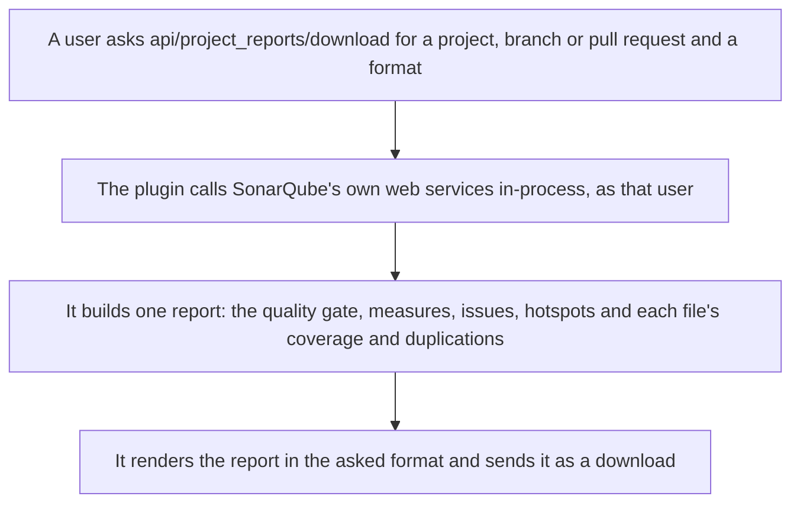

<div align="center">


# haembina-project-reports

**Issue, coverage and duplication reports for SonarQube Community Build
projects, branches and pull requests.**

[What it does](#what-it-does) · [How it works](#how-it-works) ·
[Setup](#setup-and-use) · [Commands](#commands) · [Layout](#layout) ·
[Documents](#documents)

</div>

---

## What it does

<table>
<tr>
<td width="50%" valign="top">
 <b>One report per scope</b><br>
A report covers a project's main branch, a branch or a pull request, so a review
reads one file instead of five pages.
</td>
<td width="50%" valign="top">
 <b>Quality gate and measures</b><br>
The gate's status and each condition, then coverage, duplications, issue counts
and ratings, overall and on new code.
</td>
</tr>
<tr>
<td valign="top">
 <b>Your permissions apply</b><br>
The plugin asks SonarQube's own web services in-process as the requesting user,
so a report holds only what that user may browse.
</td>
</tr>
</table>

## How it works



## Setup and use

1. Build the jar with ./gradlew assemble, or download it from a release.
2. Copy it into SonarQube's extensions/plugins directory and restart SonarQube.
3. Call api/project_reports/download with project, and branch or pullRequest
   where haembina-branch-analysis is installed.
4. Pass format=json, markdown, html, pdf, epub, csv or sarif; csv is a zip of
   one file per section.
5. Pass sections, a comma list of gate, measures, issues, hotspots, files,
   coverage and duplications, to choose what the report holds.
6. coverage lists each uncovered line and duplications each duplicated block;
   both need See Source Code permission on the project.
7. For a git provider the plugin does not recognize, set Branch link and Pull
   request link in the project's Haembina Project Reports settings.

## Commands

| Command | What it does |
| --- | --- |
| `./gradlew assemble` | Builds the plugin jar into build/libs |
| `./gradlew check` | Compiles with Error Prone and javac lint as errors and runs the Java suite under its coverage floor |
| `./gradlew pitest` | PIT mutation run over the Java suite; the report is in build/reports/pitest |

## Layout

<details>
<summary>Open the tree</summary>

```text
.
├── .devcontainer/  The dev container, on the image CI builds in
├── .github/        The workflows and Dependabot's settings
├── LICENSES/       License texts, by SPDX identifier
├── docs/           How the plugin is tested
├── e2e/            The Playwright integration suite: a setup project boots and
│                   seeds SonarQube with and without haembina-branch-analysis in
│                   Docker
├── gradle/         The Gradle wrapper
├── icons/          The project icon and the icons the documents show
└── src/            The plugin's web service, its report model and renderers,
                    and their JUnit suite
```

</details>

## Documents

[Testing](docs/testing.md) · [Changelog](CHANGELOG.md) ·
[License](LICENSE)
