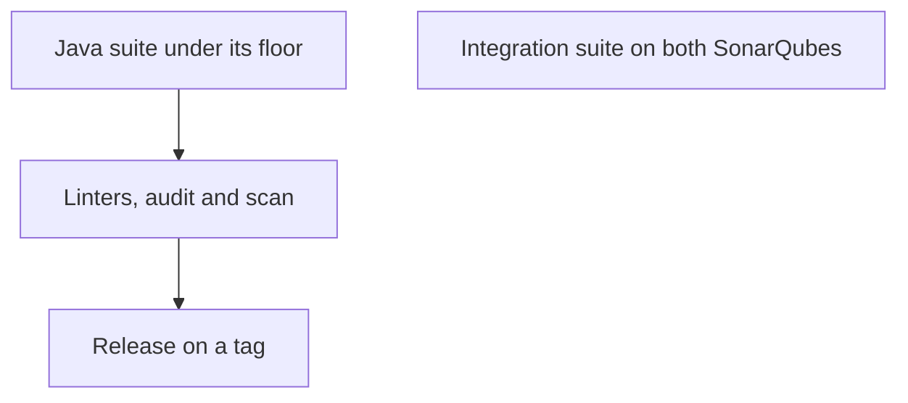

<div align="center">


# Testing

Each suite, what it proves and cannot reach, and what CI runs.

[README](/README.md) · **Testing**

</div>

---

## Suites

| | Suite | Runs | Proves | Cannot reach |
| --- | --- | --- | --- | --- |
| &nbsp;&nbsp;&nbsp;&nbsp;&nbsp; | Java suite | `./gradlew check` | The web service, the report collector and each renderer under JUnit 5, failing under the JaCoCo floor in build.gradle | A real SonarQube: the web services the plugin calls are mocked |
| &nbsp;&nbsp;&nbsp;&nbsp;&nbsp; | Integration suite | `npm run test:e2e` | The jar on SonarQube with and without haembina-branch-analysis: each scope, every section, past 10,000 issues, permissions, the missing-plugin answer | SonarQube builds other than the two images the suite pins |
| &nbsp;&nbsp;&nbsp;&nbsp;&nbsp; | Mutation runs | `./gradlew pitest` | Whether the Java assertions notice a changed line | A threshold: a score is read, not gated |

## What CI runs



## Run it

```bash
npm run gate
```

Runs what CI runs, in its order. One suite: its command from the table.
